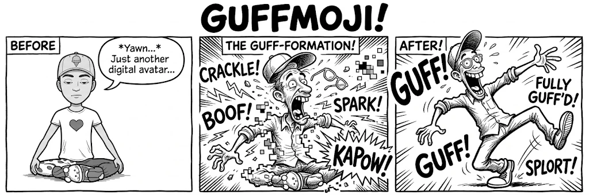
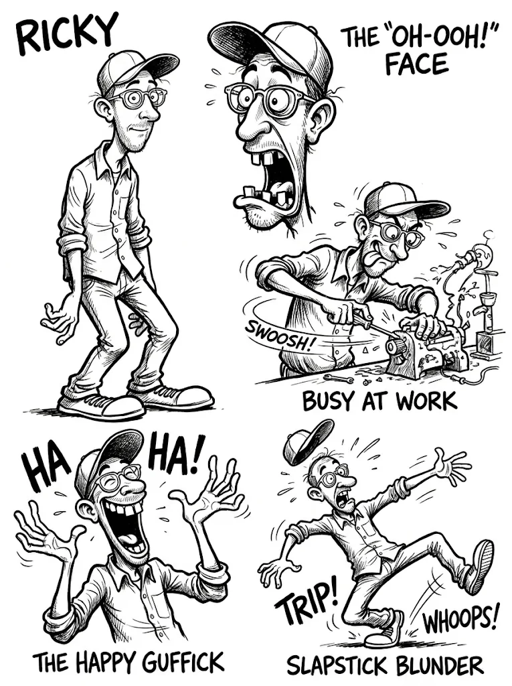
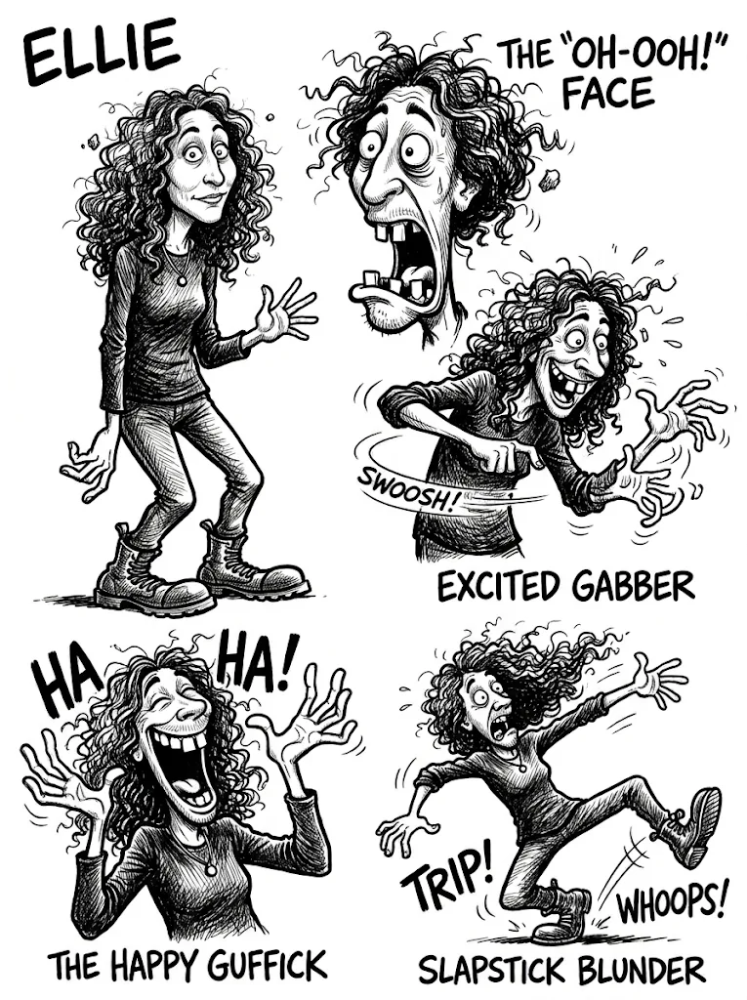
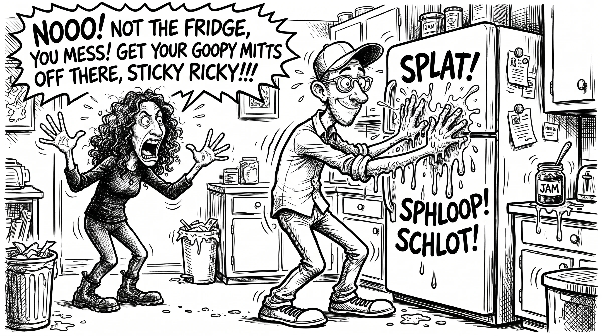

<p align="center">
  
</p>

<div align="center">

# GUFFMOJI

### Because some of us grew up with MAD Magazine, not Snapchat.

**Turn your Bitmoji, avatar, or portrait into a gloriously unhinged black-and-white comic character.**

[See examples](#the-evidence) · [Get started](#-quick-start) · [Try a prompt](#-prompt-ideas) · [How it works](#-how-it-works) · [Contribute](#-contributing)

</div>

---

## What is GuffMoji?

GuffMoji is an **Agent Skill** for image-capable AI assistants. Give it a reference image, and it helps turn you into a recurring character in the spirit of classic inked satirical comics: elastic limbs, wild expressions, frantic crosshatching, and catastrophic physical comedy.

The point isn't to make a generic cartoon of you. It's to create a **recognizable character system** you can reuse in reactions, scenes, and multi-character comics.

## ✍️ What can it do?

| Mode | What you get | Try saying |
| :--- | :--- | :--- |
| **CREATE** | A reusable character sheet from an avatar or photo | “GuffMoji this Bitmoji.” |
| **REACT** | One oversized comic reaction | “Me realizing I replied all.” |
| **SCENE** | A complete slapstick comic panel | “The printer becomes self-aware at 4:59 PM.” |
| **SHEET** | More poses and expressions for a saved character | “Six ways to react to Monday.” |

## 🚀 Quick start

1. Use an image-capable assistant that supports [Agent Skills](https://agentskills.io/specification). Install or copy [`skills/guffmoji/`](skills/guffmoji/) into the skills location supported by your assistant.
2. Upload a **Bitmoji, avatar, drawing, portrait, or existing character sheet**.
3. Say **“GuffMoji this.”** By default, the skill creates a character sheet.
4. Save your resulting sheet and attach it whenever you want another reaction or scene.

**No skill support?** Open [`SKILL.md`](skills/guffmoji/SKILL.md) and paste its instructions into an image-generation chat with your reference image. Results depend on that model's capabilities.

## 🎭 How it works

```text
Your avatar / portrait
         │
         ▼
  Identify visual anchors
  (hair, glasses, nose,
   silhouette, outfit)
         │
         ▼
  Exaggerated ink-cartoon
     character sheet
         │
         ├── REACT → reaction sticker
         ├── SHEET → more expressions
         └── SCENE → absurd comic panel
```

**Character continuity matters.** Preserve recognizable features even when the face stretches into a scream and the knees bend like plumbing. You can optionally document your character with the [character profile template](skills/guffmoji/references/character-profile.md).

## The evidence

These are the original character and scene experiments, generated with Nano Banana and supplied for this project. They show the intended look; results will vary by model.

<table>
  <tr>
    <th width="50%">Ricky</th>
    <th width="50%">Partner</th>
  </tr>
  <tr>
    <td></td>
    <td></td>
  </tr>
</table>

### Sticky Ricky



## 💬 Prompt ideas

> **CREATE:** GuffMoji this avatar. Make a sheet with a full-body pose, delighted cackle, startled scream, furious rant, and clumsy fall. Keep my defining visual features consistent.

> **REACT:** Use this character sheet. Draw me realizing I've accidentally sent the entire company my grocery list. One expression, no background.

> **SCENE:** Use these two character sheets. Ricky presses jam-covered hands against the fridge while his partner reacts in horror. Big, hand-lettered sound effects. A single chaotic black-and-white panel.

More examples in [`examples/prompts.md`](examples/prompts.md).

## 🗃️ Repository layout

```text
GuffMoji/
├── README.md
├── LICENSE
├── assets/
│   ├── guffmoji-hero.png
│   ├── example-ricky-sheet.png
│   ├── example-partner-sheet.png
│   └── example-kitchen-panel.png
├── examples/
│   └── prompts.md
└── skills/
    └── guffmoji/
        ├── SKILL.md                # the actual Agent Skill
        └── references/
            └── character-profile.md
```

## 🖊️ The aesthetic

Black ink on white paper. Rubber-limbed figures. Wild, recognizable faces. Uneven handmade lettering. Motion lines, sweat beads, vibrating machinery, and small mistakes with absurdly large consequences.

Inspired by the **broad tradition of mid-century satirical magazine cartooning**, including MAD-era comedy—not a reproduction of a specific artist's panels or signature characters.

## 🤝 Contributing

Bring your favorite absurd reaction prompt, test an unusual avatar, or suggest ways to improve character consistency. Issues and pull requests welcome! If you share example images, please make sure you have the right to publish them.

## ⚠️ A few important notes

- This is a **prompt/skill**, not a standalone app, filter, model, or hosted image-conversion service.
- Image generation, lettering accuracy, and character consistency vary by model. Reattach the character sheet for best results.
- Use only images you have permission to upload and share. Don't commit someone else's portrait or private reference without consent.
- **Bitmoji** and **MAD** are trademarks of their respective owners. GuffMoji is an independent, unofficial project and is not affiliated with either.
- The [MIT license](LICENSE) covers repository text and configuration, **not** third-party imagery, trademarks, or artworks.

---

<div align="center">

**Made for the generation that learned facial expressions from an entirely unreasonable amount of ink.**

*FWOOMP!*

</div>
